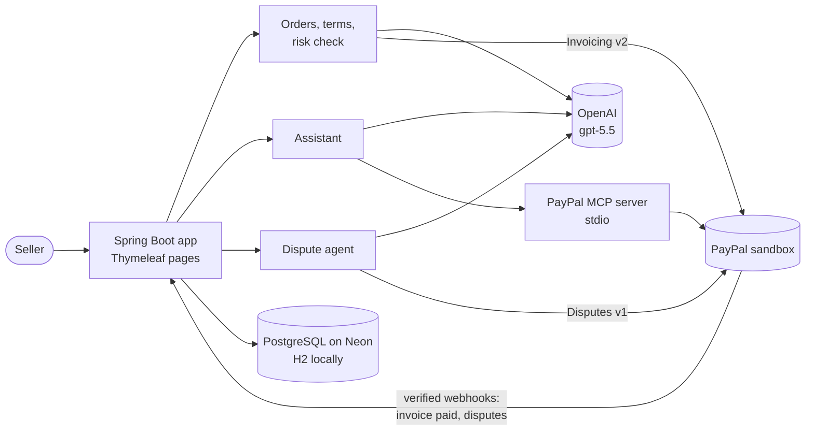

# ProofPay

**AI that prevents PayPal disputes before the sale, and builds the right evidence for any dispute after it.**

For small sellers(targetting exporters in Agra) who agree orders in chat (WhatsApp, Instagram, email) and get paid with PayPal.

Built for the [PayPal AI Hackathon 2026](https://paypalaihackathon.devpost.com/).

- **Live demo:** `https://proofpay-gkuv.onrender.com` (sandbox only; seller pages are password-protected)
- **Video:** `https://youtu.be/e4xA3yi80AA`

> The free hosting sleeps when idle. The first page load can take about a minute.

---

## The problem

Ravi makes marble coasters in Agra. Emily in Ohio orders over WhatsApp. In a long chat they agree on the size,
the blue lapis inlay, that "each one is handmade, so the pattern varies slightly", the price and the delivery date.
Ravi sends a PayPal invoice that just says "4 coasters, 1 tray".

Weeks later Emily opens a PayPal dispute. Ravi now has to:

- find the right messages among hundreds,
- work out what PayPal wants for this kind of dispute, and
- write a response before the deadline.

Meanwhile the PayPal reviewer only sees an invoice with none of the agreed details on it.

Most of these disputes start **before the sale**, with terms that were never written down where PayPal can see them.

## What ProofPay does

### Before the sale: prevent the dispute

1. **Chat to agreed terms.** The seller pastes the chat, uploads screenshots, or imports a WhatsApp export,
   in any language. The AI pulls out the items, agreed details, quantities, prices, ship-to address, delivery date
   and anything the buyer accepted, such as handmade variation.
2. **Dispute-risk check before invoicing.** ProofPay flags the problems that cause disputes later: vague specs,
   variation the buyer never accepted, a delivery date the seller can't meet, or a price that was never agreed.
   For each flag it drafts a clarifying message the seller can send to the buyer.
3. **The seller confirms.** Every field can be edited, and nothing goes to PayPal until the seller approves.
   Anything the AI could not find, such as a quantity or a price, is left empty for the seller to fill in. It is never guessed.
4. **The terms go on the PayPal invoice itself.** Each item's agreed details go in its description, and the full
   agreed terms go in the invoice's terms field. When the buyer pays, PayPal holds its own record of what they agreed to.

### After the sale: run the order

5. **Paid automatically.** A verified PayPal webhook marks the order paid.
6. **AI assistant on the PayPal MCP server.** The seller can ask in plain words, for example *"add DTDC tracking
   D1234567 to Emily's order"* or *"which orders haven't shipped?"*. The assistant reads PayPal through the
   official PayPal MCP server. **Any action that changes something waits for the seller to click Confirm.**
7. **Missing-tracking alert.** Orders paid more than 3 days ago with no tracking are highlighted.

### When a dispute arrives: answer it with evidence

8. **The dispute comes in automatically** (webhook, or "Check PayPal for disputes") and is **matched to its order**
   by invoice id or payment id.
9. **ProofPay builds an evidence pack in code**, from the order's own records, each with an id (E1, E2, …):
   - the terms on the invoice the buyer paid
   - the payment
   - tracking and what the courier says
   - **days since payment compared with this seller's usual delivery time to that country**
   - what the buyer accepted in the chat
   - a chat excerpt
10. **The AI analyses the dispute with a playbook for its reason code.** For each point of the claim it writes the
    buyer's claim, what the evidence shows, and the record that shows it. It then gives a case strength, a
    recommendation (fight, reply with an update, partial refund, or accept) and a draft response.
11. **Code checks the AI** (see [AI and code](#where-the-ai-decides-and-where-code-decides)).
12. **The seller edits and sends.** ProofPay reads **which evidence types PayPal is requesting on this dispute** and
    sends the seller's notes, tracking and proof document as the best requested type. If PayPal refuses that type,
    it tries the next one PayPal asked for. It sends only when PayPal offers the `provide_evidence` action.
    **ProofPay never accepts a claim, refunds, or sends refund proof on its own.**

---

## Where the AI decides and where code decides

The AI is good at reading messy chats in any language and at writing. It is not trusted with facts or decisions
that the code can check.

| Step | AI | Code |
| --- | --- | --- |
| Reading the chat | Extracts items, specs, terms, buyer acceptances; translates | A price counts only if that number appears in the chat; otherwise the price is cleared and flagged |
| Delivery risk | Not used | Compares the buyer's deadline with the seller's own delivery time for that country |
| Sending the invoice | Never | The seller approves; open high risks need an explicit "send anyway" |
| Assistant actions | Chooses tools and arguments | Allowlist of 8 PayPal MCP tools; every write waits for seller Confirm; refunds, cancelling and accepting claims are blocked |
| Dispute evidence | Not used | The evidence pack is built from the order's records |
| Dispute analysis | Claim points, strength, recommendation, draft reply | Every cited record must exist. A "not received" claim with no tracking is capped at weak and never "fight". Tracking marked delivered is at least medium |
| Sending evidence | Never | Seller clicks Send; only evidence types PayPal requested; never refund proof |

When code overrides the AI, the page says so in a line starting with **"ProofPay rule:"**.

## Dispute coverage

PayPal reason codes and evidence types follow
[PayPal's dispute reasons and evidence](https://developer.paypal.com/disputes/reasons-evidence) page.

| PayPal reason | Depth | What decides it |
| --- | --- | --- |
| Item not received | Deep | Tracking on file, courier status, days since payment vs the seller's usual delivery time to that country |
| Item not as described | Deep | Agreed terms on the paid invoice, each item's agreed details, what the buyer accepted in chat |
| Unauthorised payment | Light | Invoice went to the buyer's own PayPal email, ship-to address from their chat, tracking |
| Incorrect amount | Light | Agreed prices and total on the invoice they paid |
| Duplicate payment | Light | One invoice and one payment for the order |
| Paid another way | Light | Payment records; the seller checks other channels |
| Refund not received | Light | What was promised in the chat |
| Cancelled subscription | Not applicable | ProofPay sellers don't use subscriptions |

## Architecture



| Layer | Choice |
| --- | --- |
| Core | Java 21, Spring Boot 4, Spring Data JPA, Thymeleaf (no front-end build step) |
| AI | OpenAI Chat Completions with strict, forced function calling, so every answer is checked JSON; screenshots read as images |
| PayPal REST | OAuth client credentials, Invoicing v2 (create, send), webhook signature verification, Disputes v1 (get, list, provide evidence) |
| PayPal MCP | Official `@paypal/mcp` server, run as a child process over stdio through the MCP Java SDK |
| Data | H2 in memory locally, PostgreSQL on Neon in production |
| Hosting | Docker on Render (free tier) |

## Safety choices

- **Chats are untrusted.** Buyer messages and PayPal dispute data are passed to the AI inside tags and treated as
  data. A message that tries to steer the AI can only change a draft the seller reviews.
- **No action without the seller.** Invoices, tracking, reminders and dispute evidence all wait for a seller click.
  Refunds, cancelling invoices and accepting claims are blocked in the assistant and never done by the dispute agent.
- **Every webhook is verified with PayPal** before it can change an order, because the webhook URL is public.
- **Idempotent.** Repeated webhooks are recorded and ignored, invoices use a PayPal request id, and double-clicking
  approve cannot send two invoices.
- **External calls run outside database transactions**, so a slow PayPal or OpenAI call never holds a lock.
- **Secrets stay out of the code.** Keys come from environment variables, `.env` is git-ignored, and error messages
  never echo keys. Seller pages are behind a password on the public URL.

---

## Run it locally

Requirements: **Java 21**. Maven comes with the project through the wrapper. Node.js 22 is needed only for the assistant.

```bash
cp .env.example .env        # Windows: copy .env.example .env
./mvnw spring-boot:run      # Windows: .\mvnw.cmd spring-boot:run
```

Open http://localhost:8080.

With `PAYPAL_MODE=mock` and `AI_MODE=mock` in `.env`, you can click through creating an order, the risk check,
approving and "simulate payment" with no accounts. Mock AI returns a fixed sample, not real analysis. The assistant
and disputes need the real PayPal sandbox.

### Connect the real services

Fill in `.env`. The app reads it automatically. Never commit it.

| Variable | What it is |
| --- | --- |
| `PAYPAL_MODE=live` | Use the PayPal sandbox instead of mock |
| `PAYPAL_BASE_URL` | `https://api-m.sandbox.paypal.com` |
| `PAYPAL_CLIENT_ID`, `PAYPAL_CLIENT_SECRET` | developer.paypal.com → Apps & Credentials → Sandbox → your app |
| `PAYPAL_WEBHOOK_ID` | Same app → Webhooks → add `https://<your-url>/webhooks/paypal` with **Invoicing: Invoice paid**, **Customer dispute created**, **updated** and **resolved** |
| `PAYPAL_ALLOW_UNVERIFIED_WEBHOOKS` | `false`. Only for local testing; never `true` on a public URL |
| `AI_MODE=live`, `OPENAI_API_KEY`, `AI_MODEL` | platform.openai.com → API keys; model `gpt-5.5` |
| `SELLER_NAME` | Shown on invoices |
| `SELLER_PASSWORD` | Protects the seller pages (user name `seller`). Required on any public URL |
| `SHIPPING_DAYS` | The seller's usual delivery times, e.g. `US=12-20,GB=10-18,*=15-25`. Editable later on the Settings page |
| `DB_URL`, `DB_USER`, `DB_PASSWORD` | Leave empty for H2. For Postgres, a JDBC URL such as `jdbc:postgresql://<host>/<db>?sslmode=require` |
| `PAYPAL_MCP_COMMAND` | Locally: `npx -y @paypal/mcp --tools=all`. The Docker image sets its own |

To buy as the customer, create a **US** sandbox personal account. The seller account is India-based, and PayPal
blocks INR-to-INR cross-border invoices in the sandbox. Log in at sandbox.paypal.com and pay the invoice from its link.

## Deploy

1. Create a free PostgreSQL database on [Neon](https://neon.tech) and copy its JDBC URL.
2. On [Render](https://render.com): **New → Web Service** → this repo → **Docker**. The `Dockerfile` builds the
   app and installs a pinned PayPal MCP server into the image.
3. Add the environment variables above (`PAYPAL_MODE=live`, `AI_MODE=live`, `THYMELEAF_CACHE=true`, the database
   variables and a `SELLER_PASSWORD`). Don't set `PAYPAL_MCP_COMMAND` on Render.
4. Point the PayPal sandbox webhook at `https://<service>.onrender.com/webhooks/paypal`, and put its id in
   `PAYPAL_WEBHOOK_ID`.

## Tests

```bash
./mvnw verify               # Windows: .\mvnw.cmd verify
```

The tests run with mock PayPal and mock AI, so they need no secrets. GitHub Actions runs them on every push. They cover:

- **Orders:** agreed-terms text, approval checks, the order lifecycle
- **AI checks:** the price-must-appear-in-chat check, delivery windows
- **PayPal:** webhook verification and duplicate handling
- **Assistant:** a write waits for Confirm, a cancelled action never runs, blocked tools never run
- **Disputes:** citations must exist, the "not received" rules, picking the evidence type PayPal requested, never sending refund proof

---

## Honest notes and limits

- **Sandbox only.** Nothing here touches real money.
- **No real courier in the sandbox.** Tracking numbers are test values. On the dispute page the seller sets what the
  courier says (unknown, in transit, delivered), and ProofPay uses that.
- **Reaching the evidence stage in the sandbox.** A new dispute starts as an *inquiry*, where PayPal expects the
  seller to message the buyer, not send evidence. For testing, we escalated the dispute to a claim and used PayPal's
  sandbox-only `require-evidence` call to make it ask for seller evidence.
- **Evidence types are PayPal's choice.** On our test dispute, PayPal refused a tracking number alone and accepted
  evidence with a document attached. That is why the dispute page asks for a courier receipt and sends only the types
  PayPal requests.
- **Not built yet:**
  - replying to the buyer at the inquiry stage (the draft could go through PayPal's `send_message`)
  - a link for the buyer to confirm the terms before paying
  - changing terms on an invoice that was already sent
  - direct WhatsApp integration (today it's paste, screenshots or a WhatsApp export file)

## AI tools used

- **OpenAI (gpt-5.5)** inside the product: chat-to-terms extraction, the risk check, the assistant, and dispute analysis.
- **PayPal MCP server** gives the assistant its PayPal tools.

## License

MIT, see [LICENSE](LICENSE).
